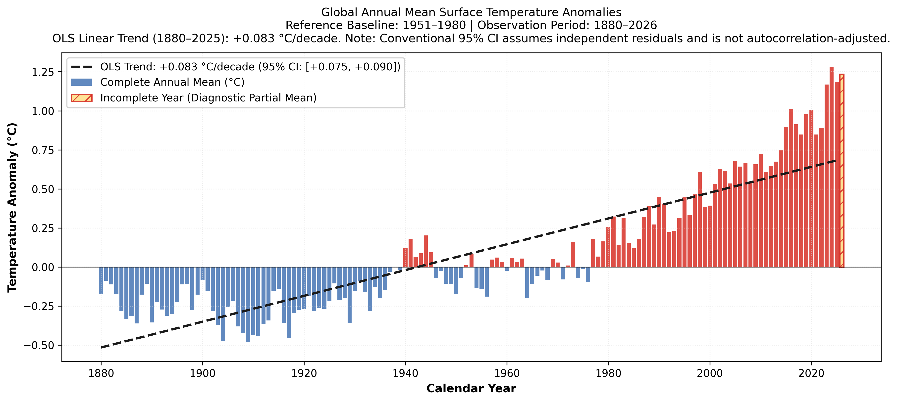
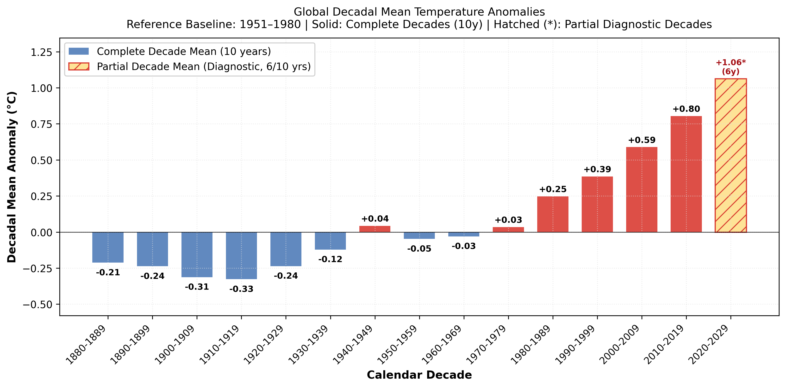
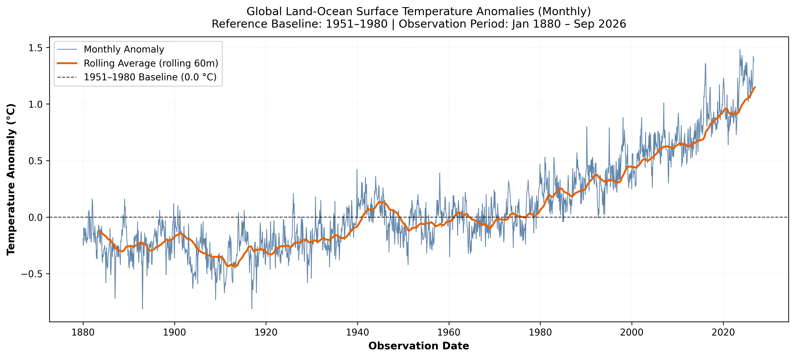
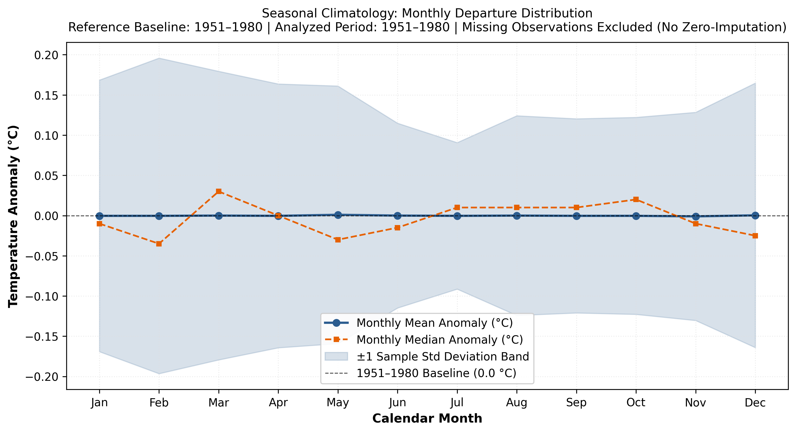

# Climate Trend Analyzer: Historical Climate Data Analysis and Trend Estimation System

[](https://www.python.org/downloads/)
[](tests/)
[](pyproject.toml)
[](LICENSE)
[](https://data.giss.nasa.gov/gistemp/)

Climate Trend Analyzer is a modular, production-grade Python data science system designed for the rigorous ingestion, validation, statistical analysis, and interactive exploration of long-term global climate observations.

The system evaluates historical global land and ocean surface temperature departures from the authoritative NASA Goddard Institute for Space Studies (GISS) Surface Temperature Analysis version 4 (GISTEMP v4) Land-Ocean Temperature Index (L-OTI), evaluated against the official 1951-1980 climatological baseline.

---

## Executive Summary for Technical Leaders and Managers

### Business and Scientific Objectives
Understanding historical temperature trajectories requires verifiable data pipelines, defensible statistical models, and clear separation of complete from incomplete observation intervals. This project provides:
1. Automated ingestion and physical boundary validation for climate anomaly time series.
2. Conservative preprocessing that strictly prohibits synthetic zero-imputation.
3. Parametric (Ordinary Least Squares) and non-parametric (Sen's slope, Mann-Kendall) trend estimation.
4. Completeness tracking across calendar years and decadal periods.
5. An interactive Streamlit exploration dashboard for domain specialists and stakeholders.

### Key Verified Findings (1880-2025 Complete Observation Record)
All reported figures are derived directly from the official NASA GISTEMP record (1880 through September 2026):
* Observed Record Scope: 146 complete calendar years (1880 through 2025), comprising 1,761 valid monthly observations.
* Ordinary Least Squares (OLS) Linear Warming Rate: +0.0826 deg C per decade (+0.008262 deg C per year, R-squared = 0.7646).
* Sen's Robust Non-Parametric Slope: +0.0804 deg C per decade (+0.008038 deg C per year, rank-based 95% confidence interval: [+0.0720, +0.0892] deg C per decade across 10,585 pairwise slopes).
* Mann-Kendall Monotonic Trend Test: Statistically significant upward trend (Standardized Z = +13.0234, Kendall S = +7,698, two-sided p = 9.01e-39, exact Kendall 1975 tie correction).
* Warmest Complete Calendar Year: 2024 (+1.2817 deg C anomaly relative to the 1951-1980 baseline).
* Latest Complete Calendar Year: 2025 (+1.1850 deg C anomaly).
* Ongoing Incomplete Year (2026 Diagnostic): +1.2344 deg C arithmetic mean across nine observed months (January through September 2026). In accordance with data integrity rules, its annual mean anomaly is strictly maintained as NaN and excluded from completed-year trend models.
* Ongoing Decadal Diagnostic (2020-2029): Arithmetic mean of +1.063 deg C across six complete years (2020-2025). Categorized strictly as an incomplete diagnostic period.

### Methodological and Statistical Disclaimers
* Serial Autocorrelation Notice: Regression residuals display strong positive first-order autocorrelation (lag-1 r1 = +0.7987, Durbin-Watson d = 0.3346). Because conventional OLS and standard Mann-Kendall formulations assume independent errors, nominal standard errors are deflated and confidence intervals ([+0.0751, +0.0902] deg C per decade) are not autocorrelation-adjusted.
* Observational Scope: Statistical trends describe historical observations; they do not attribute warming to anthropogenic versus natural forcing.
* No Future Projections: This project is strictly observational and does not substitute for physics-based General Circulation Models (GCMs / CMIP6).

---

## Visual Analytics Gallery

Curated high-resolution visual outputs generated by the analysis pipeline. All images are stored in the images/ directory:

### 1. Annual Mean Anomalies and OLS Linear Trend
Displays complete annual means (1880-2025) categorized into warm departures (red) and cool departures (blue), complete with the OLS regression trend line and diagnostic treatment of the incomplete 2026 year.


### 2. Decadal Summary and Completeness Tracking
Calendar decades grouped according to standard boundaries (1880-1889 through 2020-2029). Decades requiring 10 complete years are clearly separated from the ongoing diagnostic 2020-2029 decade.


### 3. Monthly Anomaly Timeline and Rolling Averages
High-resolution monthly time series (1880-2026) overlaid with a 60-month (5-year) backward trailing average. Missing values are preserved as clean line breaks without zero-imputation.


### 4. Seasonal Climatology Distribution
Evaluates the distribution of 1951-1980 baseline departures across all 12 calendar months (January through December) with mean departure curves and plus/minus 1 sample standard deviation envelopes.


Note: Users can place additional screenshots, dashboard captures, or regional figures directly into the images/ folder.

---

## Architecture and Engineering Design

```text
data/raw/GLB.Ts+dSST.csv
       |
       v
src/climate_analyzer/data_loader.py         (CSV Ingestion & Schema Extraction)
       |
       v
src/climate_analyzer/data_validation.py     (Physical Bounds [-10C, +10C] & Temporal Checks)
       |
       v
src/climate_analyzer/data_cleaning.py       (Parse NASA markers to NaN; Defensive Copies)
       |
       v
src/climate_analyzer/feature_engineering.py (Trailing Rolling Means & Annual Completeness)
       |
       +---> src/climate_analyzer/analysis/descriptive_analysis.py (Decadal Aggregates & Moments)
       +---> src/climate_analyzer/analysis/trend_analysis.py       (Centered OLS, Mann-Kendall, Sen's Slope)
       |
       +---> src/climate_analyzer/visualization/climate_plots.py   (Publication Matplotlib Figures)
       +---> app/streamlit_app.py                                  (Interactive Web Dashboard)
       +---> reports/climate_trend_analysis_report.md             (Technical Portfolio Report)
```

### Module Responsibilities and Implementation Status

| Module Path | Stage | Primary Responsibility | Implementation Status |
| :--- | :--- | :--- | :--- |
| src/climate_analyzer/data_loader.py | Ingestion | Parse NASA tabular CSV structures and extract monthly series. | Implemented and Verified |
| src/climate_analyzer/data_validation.py | Validation | Enforce schema constraints, physical bounds, and chronological order. | Implemented and Verified |
| src/climate_analyzer/data_cleaning.py | Cleaning | Parse NASA asterisk markers to IEEE 754 NaN; prohibit zero-imputation. | Implemented and Verified |
| src/climate_analyzer/feature_engineering.py | Features | Trailing rolling windows (12m, 60m, 120m), annual completeness flags. | Implemented and Verified |
| src/climate_analyzer/analysis/descriptive_analysis.py | Analysis | Summary moments, 10-year decadal summaries, monthly climatology. | Implemented and Verified |
| src/climate_analyzer/analysis/trend_analysis.py | Analysis | Centered OLS regression, Mann-Kendall monotonic test, Sen's slope. | Implemented and Verified |
| src/climate_analyzer/visualization/climate_plots.py | Graphics | Publication-ready Matplotlib figures with explicit memory management. | Implemented and Verified |
| app/streamlit_app.py | Dashboard | Interactive multi-tabbed web interface for exploration and diagnostics. | Implemented and Verified |
| reports/climate_trend_analysis_report.md | Reporting | Formal technical report documenting methods, results, and limitations. | Implemented and Verified |
| src/climate_analyzer/analysis/seasonal_analysis.py | Analysis | Classical and STL seasonal cycle decomposition. | Planned |
| src/climate_analyzer/analysis/anomaly_detection.py | Analysis | Extreme Value Theory and interquartile range anomaly flagging. | Planned |
| scripts/run_analysis.py | Automation | Command-line execution entry point for non-interactive pipelines. | Planned |

---

## Installation and Setup

### 1. Prerequisites
* Python 3.10 or higher.
* Git installed on your system.

### 2. Environment Setup

On Windows (PowerShell):
```powershell
python -m venv .venv
.\.venv\Scripts\Activate.ps1
```

On Windows (Command Prompt cmd.exe):
```cmd
python -m venv .venv
.\.venv\Scripts\activate.bat
```

On macOS / Linux:
```bash
python3 -m venv .venv
source .venv/bin/activate
```

### 3. Install Dependencies and Package
```bash
# Upgrade pip package installer
python -m pip install --upgrade pip

# Install runtime, development, and testing dependencies
pip install -r requirements-dev.txt

# Install climate_analyzer in editable development mode
pip install -e .
```

---

## Dataset Acquisition and Placement

The primary dataset is the official NASA GISTEMP v4 Global Land-Ocean Temperature Index (L-OTI):

1. Source Provider: NASA Goddard Institute for Space Studies (GISS).
2. Direct Download URL:
   https://data.giss.nasa.gov/gistemp/tabledata_v4/GLB.Ts+dSST.csv
3. Target Placement Path:
   Save the downloaded CSV file directly to:
   ```text
   data/raw/GLB.Ts+dSST.csv
   ```
4. Integrity Checksum:
   Expected SHA-256 Checksum: `4c64eda288bce32b8d76926278f346ecea1e53506df8ee72a3d5accb0657c416`
5. Error Handling:
   If the file is absent, the pipeline raises a structured FileNotFoundError, and the Streamlit dashboard displays an actionable recovery banner without crashing.

---

## Quality Assurance and Automated Testing

Run the deterministic test suite:

```bash
pytest
```

To run the complete test suite with statement coverage reporting across packages and the application:

```bash
pytest --cov=climate_analyzer --cov=app --cov-report=term-missing tests/
```

### Verification Metrics:
* Total Automated Tests: 131 passed in 4.2 seconds.
* Failures, Errors, Warnings: 0 failures, 0 errors, 0 warnings.
* Statement Coverage: 80% repository-wide coverage (core analytical packages achieve 85% to 94% coverage; Streamlit application achieves 36% coverage via pure helper functions).
* Static Code Hygiene: Zero whitespace issues or merge conflict markers reported by git diff --check.

---

## Interactive Dashboard Execution

To launch the interactive exploration dashboard on your local machine:

```bash
streamlit run app/streamlit_app.py
```

After starting, navigate to `http://localhost:8501` in your web browser.

### Dashboard Functional Modules:
1. Overview: Metric KPI cards (Latest Complete Year, Ongoing Diagnostic Year, Warmest Complete Year, Decadal Trend Rate) and an interactive monthly timeline with selectable 12-month, 60-month, and 120-month trailing rolling averages.
2. Historical Trends: Annual mean anomalies, complete versus incomplete year bar styling, OLS linear trend overlay, comparative statistical cards (OLS, Mann-Kendall, Sen's slope), and residual autocorrelation alerts (r1 approximately +0.80, Durbin-Watson d approximately 0.33).
3. Seasonal Patterns: Calendar-month departure distributions (January through December), climatological evaluation window controls (1951-1980 baseline window, full record, recent 30-year window, or custom window) summarizing 1951-1980 base anomalies, and plus/minus 1 standard deviation envelopes.
4. Decadal Comparison: 10-year decadal means alongside partial diagnostic periods (highlighting the ongoing 2020-2029 interval).
5. Data Quality and Methodology: Dataset provenance, validation checks, zero-imputation prohibition notes, and scientific scope boundaries.

---

## Technical Documentation and Reports

Additional technical specifications are maintained in the repository:
* Technical Portfolio Report: reports/climate_trend_analysis_report.md
* System Architecture Blueprint: docs/architecture.md
* Data Pipeline and Feature Dictionary: docs/data_pipeline.md
* Analytical and Statistical Methods: docs/model_details.md
* Data Governance and Storage Policy: data/README.md
* Chronological Execution and Audit Log: docs/execution_log.md

---

## Planned Future Extensions

The following enhancements are identified for future development phases:
* Seasonal-Trend Decomposition using Loess (STL) in seasonal_analysis.py.
* Algorithmic Extreme Event Detection using Interquartile Range and Extreme Value Theory in anomaly_detection.py.
* Serial Autocorrelation Adjustments via Prais-Winsten and Cochrane-Orcutt Generalized Least Squares.
* Gridded Spatial Ingestion for raster NetCDF datasets.

---

## License and Attribution

* Software License: MIT License.
* Climate Dataset: Public Domain under the NASA Open Data Policy.
* Citations:
  * GISTEMP Team, 2026: GISS Surface Temperature Analysis (GISTEMP), version 4. NASA Goddard Institute for Space Studies. Dataset accessed 2026-10-16 at https://data.giss.nasa.gov/gistemp/.
  * Lenssen, N., et al., 2024: A GISTEMPv4 observational uncertainty ensemble. Journal of Geophysical Research: Atmospheres, 129, e2023JD040179, doi:10.1029/2023JD040179.
