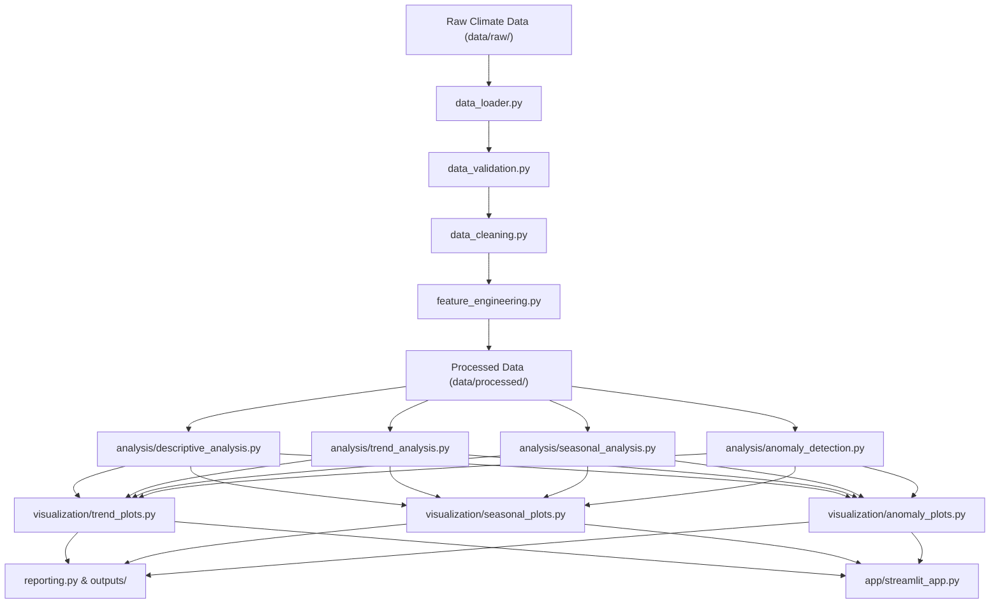

# System Architecture & Technical Specifications

## 1. Architectural Overview

The **Climate Trend Analyzer** is structured around a modular pipeline architecture with clean separation of concerns:

---

## 2. Planned Modules & Responsibilities

| Module Path | Stage | Primary Responsibility | Status |
| :--- | :--- | :--- | :--- |
| `src/climate_analyzer/data_loader.py` | Ingestion | Load tabular GISTEMP formats (CSV, buffers) with schema and anomaly validation. | **Implemented & Verified** |
| `src/climate_analyzer/data_validation.py` | Validation | Assert column schema types, physical boundary checks, and temporal consistency. | **Implemented & Verified** |
| `src/climate_analyzer/data_cleaning.py` | Preprocessing | Standardize missing observation masks, handle gaps, and resolve duplicates. | **Implemented & Verified** |
| `src/climate_analyzer/feature_engineering.py` | Transformation | Derive climatological baselines, rolling averages, anomalies, and temporal features. | **Implemented & Verified** |
| `src/climate_analyzer/analysis/descriptive_analysis.py` | Analysis | Compute distribution moments, quantiles, decadal aggregates, warmth rankings, and monthly climatology. | **Implemented & Verified** |
| `src/climate_analyzer/analysis/trend_analysis.py` | Analysis | Parametric (OLS with centered time coordinates) and non-parametric (Mann-Kendall tie-corrected, Sen's slope) trend estimators. | **Implemented & Verified** |
| `src/climate_analyzer/visualization/climate_plots.py` | Visuals | Reusable, publication-ready Matplotlib plots: monthly anomaly time series, annual summaries (complete vs. incomplete), decadal summaries, and monthly climatology. | **Implemented & Verified** |
| `src/climate_analyzer/analysis/seasonal_analysis.py` | Analysis | Seasonal cycle decomposition (additive/multiplicative STL), monthly subseries analysis. | *Planned* |
| `src/climate_analyzer/analysis/anomaly_detection.py` | Analysis | Detect temperature/precipitation extreme events via statistical thresholds and IQR. | *Planned* |
| `src/climate_analyzer/reporting.py` | Reporting | Produce reproducible markdown/HTML summary tables and metric cards. | *Planned* |
| `app/streamlit_app.py` | Dashboard | User-interactive interface for exploratory time-slice filtering and visualization. | **Implemented & Verified** |
| `scripts/run_analysis.py` | Orchestration | CLI execution script to run end-to-end analytical pipeline without UI. | *Planned* |

---

## 3. Design Principles
1. **Immutable Raw Data**: Data inside `data/raw/` is never modified in-place.
2. **Pure & Testable Functions**: Preprocessing and analytical routines will take explicit parameters and return explicit outputs (DataFrames or typed data structures).
3. **No Fabricated Data**: No empirical results or synthetic climate metrics will be introduced before ingesting an authoritative, documented dataset.
4. **Distinction from Physics Models**: Data-driven statistical trends reflect observed historical data and do not substitute for physics-based GCM climate projections.
