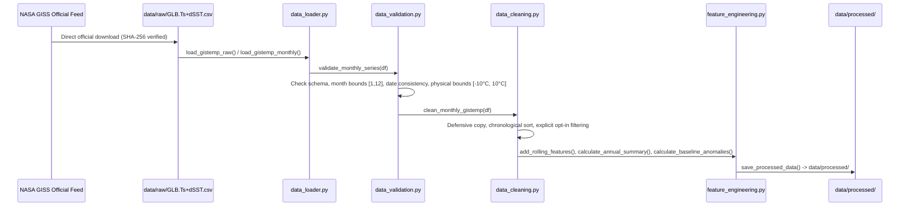

# Data Pipeline & Flow

## 1. Dataset Overview: NASA GISTEMP v4
* **Source:** NASA Goddard Institute for Space Studies (GISS)
* **Dataset Identifier:** GISTEMP Surface Temperature Analysis v4 (Land-Ocean Temperature Index, L-OTI)
* **Official URL:** `https://data.giss.nasa.gov/gistemp/`
* **Direct Download:** `https://data.giss.nasa.gov/gistemp/tabledata_v4/GLB.Ts+dSST.csv`
* **Local Raw Storage:** `data/raw/GLB.Ts+dSST.csv` (untracked in Git per immutability and storage policy)
* **File Size:** `12,886 bytes` | **SHA-256:** `4c64eda288bce32b8d76926278f346ecea1e53506df8ee72a3d5accb0657c416`
* **Granularity & Horizon:** Monthly observations from 1880 through present (updated monthly)
* **Measurement Units:** Degrees Celsius (°C) temperature anomaly relative to the **1951–1980 climatological baseline**
* **Missing Value Convention:** `***` for missing/pending months or incomplete meteorological season averages

---

## 2. Ingestion, Validation & Transformation Flow


---

## 3. Data Schema & Feature Dictionary

### 3.1 Raw Ingestion Schema (`load_gistemp_raw`)
19 columns representing the official NASA table:
* `Year`: Integer calendar year (1880–2026+)
* `Jan` – `Dec`: Monthly mean anomalies (°C, `float64`, `NaN` for missing)
* `J-D`: Calendar year mean anomaly (Jan–Dec, `float64`)
* `D-N`: Meteorological year mean anomaly (Dec–Nov, `float64`)
* `DJF`, `MAM`, `JJA`, `SON`: 3-month seasonal mean anomalies (`float64`)

### 3.2 Tidy Monthly Schema (`load_gistemp_monthly` / `clean_monthly_gistemp`)

| Column / Feature | Data Type | Physical Unit | Description |
| :--- | :--- | :--- | :--- |
| `year` | `int64` | Years CE | Observation calendar year (e.g., 1880, 2026) |
| `month` | `int64` | Month index | Month of observation (1 = Jan, ..., 12 = Dec) |
| `date` | `datetime64[ns]` | ISO date | Timestamp representing the 1st day of the observation month (`YYYY-MM-01`) |
| `anomaly` | `float64` | °C | Global land-ocean surface temperature anomaly relative to 1951–1980 baseline |

### 3.3 Engineered Features Schema (`feature_engineering.py`)

#### A. Rolling Window Features (`add_rolling_features`)
* `anomaly_rolling_12m` (`float64`): Trailing 12-month backward rolling mean (°C). Requires $\ge 9$ valid months ($\ge 75\%$). No future leakage.
* `anomaly_rolling_60m` (`float64`): Trailing 60-month (5-year) backward rolling mean (°C). Requires $\ge 45$ valid months ($\ge 75\%$).
* `anomaly_rolling_120m` (`float64`): Trailing 120-month (10-year) backward rolling mean (°C). Requires $\ge 90$ valid months ($\ge 75\%$).
* `anomaly_centered_{W}m` (`float64`): *Retrospective descriptive smoothing* (computed only when `center=True` is explicitly requested). Uses future observations relative to the timestamp and is strictly unsuitable for causal prediction.

#### B. Annual Summaries (`calculate_annual_summary`)
* `annual_mean_anomaly` (`float64`): Complete calendar-year mean anomaly (°C). Evaluates strictly to `NaN` if valid months $< 12$ to prevent partial-year figures from being mislabeled as complete annual averages.
* `valid_months` (`int64`): Count of non-null monthly observations in the calendar year.
* `total_months` (`int64`): Total monthly row count in the calendar year.
* `completeness_pct` (`float64`): Percentage of year observed (`valid_months / 12 * 100`).
* `is_complete` (`bool`): `True` if `valid_months == 12` (or meets configurable threshold).
* `partial_year_mean` (`float64`): Diagnostic arithmetic mean across available months, preserving partial-year diagnostics for ongoing years.

#### C. Multi-Baseline Reference Anomalies (`calculate_baseline_anomalies`)
* `anomaly_base_{start}_{end}` (`float64`): Re-centered monthly anomalies calculated by subtracting the separate 12-calendar-month climatological means computed over `[start, end]`.
* *Scientific Context:* Original NASA anomalies use 1951–1980. Re-centering to early instrumental periods (e.g., 1880–1900) provides an early-instrumental proxy, but is not labeled definitively as pre-industrial without qualification (IPCC references 1850–1900).

#### D. Year-over-Year Rate of Change (`calculate_year_over_year_change`)
* `yoy_change_deg_c` (`float64`): Absolute annual rate of change in degrees Celsius ($\Delta Y_t = Y_t - Y_{t-1}$).
* Requires consecutive complete calendar years (`require_complete=True`). Evaluates to `NaN` when comparing an incomplete year against a complete predecessor. Percentage changes are avoided because temperature anomalies oscillate around 0°C.

### 3.4 Analytical Results Schemas (`climate_analyzer.analysis`)

#### A. Descriptive Statistics (`DescriptiveStatisticsResult`)
* `count`: Count of valid complete annual observations.
* `mean`: Sample arithmetic mean anomaly (°C).
* `std`: Unbiased sample standard deviation (°C, `ddof=1`).
* `min` / `max`: Minimum and maximum observed annual anomalies (°C).
* `median`: 50th percentile anomaly (°C).
* `iqr`: Interquartile range (75th percentile minus 25th percentile, °C).
* `skewness`: Fisher-Pearson sample skewness coefficient.
* `kurtosis`: Fisher excess kurtosis (normal distribution = 0.0).
* `percentiles`: User-selected quantile dictionary (default 10th, 25th, 50th, 75th, 90th).

#### B. Decadal Aggregation Schema (`calculate_decadal_summary`)
* Decades follow standard astronomical/calendar boundaries: `1880–1889`, `1890–1899`, ..., `2020–2029`.
* Decades with fewer than `min_valid_years` (default 10) have `complete_decade_mean = NaN` and `is_complete = False`.
* Partial decades (such as 2020–2029 with 6 complete years) report an explicit `partial_decade_mean` for diagnostic purposes.

#### C. Warmth Rankings Schema (`calculate_warmth_percentiles`)
* `warmth_rank`: Integer rank where Rank 1 = warmest observed year (or coldest if `ranking_order='coldest_first'`).
* `percentile_score`: Empirical percentile score relative to explicit reference distribution (e.g. 1951–1980 baseline), calculated using the empirical cumulative distribution function (ECDF):
  $$\text{Percentile Score} = 100 \times \frac{\sum_{i=1}^{N_{\text{ref}}} \mathbb{I}(x_i \le x_{\text{target}})}{N_{\text{ref}}}$$
* `reference_period`: Label documenting the reference window used (e.g. `1951-1980`).

#### D. OLS Linear Trend Schema (`OLSTrendResult`)
* `slope_per_year` / `slope_per_decade`: Linear rate of temperature change (°C/year and °C/decade).
* `intercept`: Fitted anomaly value at the centered year coordinate ($t^* = \text{year} - \bar{t}$).
* `center_year`: Centered mean year used to eliminate collinearity and guarantee numerical precision.
* `std_err_per_decade`: Standard error of decadal slope.
* `p_value`: Two-sided p-value testing $H_0: \beta = 0$ under OLS assumptions.
* `ci_lower_per_decade` / `ci_upper_per_decade`: 95% analytical Student's t confidence interval.
* `r_squared`: Coefficient of determination ($R^2$).
* `residual_autocorr_lag1`: Empirical lag-1 autocorrelation coefficient ($r_1$) of regression residuals.
* `durbin_watson`: Durbin-Watson $d$ test statistic for first-order residual serial correlation ($d \approx 2(1 - r_1)$).
* `assumptions_note`: Caveat explaining that positive serial autocorrelation can inflate significance.

#### E. Mann–Kendall Monotonic Trend Schema (`MannKendallResult`)
* `s_statistic`: Kendall's $S = \sum_{k=1}^{n-1} \sum_{j=k+1}^n \text{sgn}(x_j - x_k)$.
* `var_s`: Variance of $S$ with exact Kendall (1975) tie correction.
* `z_statistic`: Continuity-corrected standardized normal score.
* `p_value`: Two-sided standard normal p-value calculated via survival function `2 * norm.sf(|Z|)` to prevent premature floating-point underflow.
* `log10_p_value`: Base-10 logarithm of the two-sided p-value, preserving exact order of magnitude even when $p \ll 10^{-15}$.
* `trend_direction`: `'increasing'`, `'decreasing'`, or `'no_trend'` (conditioned on $\alpha = 0.05$).
* `method_variant`: Specification of tie correction and normal approximation variant.

#### F. Sen's Robust Slope Estimator (`SensSlopeResult`)
* `slope_per_year` / `slope_per_decade`: Median of all valid pairwise slopes $S_{ij} = (y_j - y_i) / (t_j - t_i)$.
* `pairwise_slopes_count`: Number of pairwise slopes evaluated ($n(n-1)/2$).
* `ci_lower_per_decade` / `ci_upper_per_decade`: Non-parametric rank-based 95% confidence interval (Gilbert 1987 / Sen 1968) using exact 0-based index correction.

#### G. Monthly Climatology Distribution (`calculate_monthly_climatology`)
* Evaluates 12 calendar months (Jan–Dec) across all available observations or an explicit `[reference_start, reference_end]` window.
* **Baseline Distinction:** Summarizes existing 1951–1980 baseline anomalies across the selected evaluation window; it does **not** re-center or rebaseline the anomalies. To re-center anomalies, use `calculate_baseline_anomalies()`.
* Missing observations are strictly excluded with `.dropna()`; zero-imputation is strictly prohibited.
* Outputs `mean_anomaly`, sample standard deviation `std`, `median`, IQR (`q25`, `q75`), and extremes (`min`, `max`) per month.

### 3.5 Visualization Layer APIs (`climate_analyzer.visualization.climate_plots`)

| Function | Input Data | Key Visualization Semantics | Safeguards |
| :--- | :--- | :--- | :--- |
| `plot_monthly_anomalies` | Monthly DataFrame (`date`, `anomaly`) | Continuous time series with optional rolling average overlay; 1951–1980 baseline reference line. | NaNs preserved as line breaks (no imputation); defensive copy. |
| `plot_annual_anomalies` | Annual DataFrame (`year`, `annual_mean_anomaly`, `partial_year_mean`) | Solid bars for complete years; hatched/hollow bars for incomplete years; optional OLS trend line overlay. | `partial_year_mean` never treated as complete; OLS fit strictly on complete years; non-autocorrelation-adjusted CI disclaimer. |
| `plot_decadal_summary` | Decadal summary or annual summary DataFrame | Solid bars for complete 10-year decades; hatched bars with annotation for partial decades (e.g. 2020–2029). | Partial decades never presented as equivalent to complete decades. |
| `plot_seasonal_patterns` | Monthly DataFrame or climatology DataFrame | 12-month climatological departure curve with $\pm 1$ std dev envelope and median line. | Zero-imputation prohibited; documented reference period. |

---

## 4. Statistical Safeguards & Scientific Limitations

1. **Serial Autocorrelation Caveat**: Annual global mean temperature series often exhibit positive serial autocorrelation (due to ocean heat capacity and multi-year climate modes like ENSO). Conventional OLS t-tests and standard Mann-Kendall assume independent errors; positive serial autocorrelation increases variance and can artificially inflate statistical significance.
2. **Non-Causal Interpretation**: Statistical significance demonstrates observational trends in historical records; it does **not** prove physical climate attribution, isolate human forcing from natural modes, or substitute for physics-based GCM climate projections.
3. **Incomplete Year Protection**: Incomplete years (such as 2026 with 9 observed months) are strictly excluded from complete annual statistical analyses and decadal averages by default.
4. **No Zero-Imputation**: Missing monthly observations are never filled with 0.0 °C. Because 0.0 °C represents the exact 1951–1980 climatological baseline, imputing zero would fabricate synthetic "normal" observations and bias climate metrics.

---

## 5. Reproducible End-to-End Pipeline Example

```python
from pathlib import Path
import matplotlib.pyplot as plt

from climate_analyzer import (
    load_gistemp_monthly,
    clean_monthly_gistemp,
    add_rolling_features,
    calculate_annual_summary,
    plot_monthly_anomalies,
    plot_annual_anomalies,
)

# 1. Ingest official NASA GISTEMP monthly records
raw_file = Path("data/raw/GLB.Ts+dSST.csv")
monthly_df = load_gistemp_monthly(raw_file)

# 2. Clean and engineer features
clean_df = clean_monthly_gistemp(monthly_df)
feat_df = add_rolling_features(clean_df, windows=(60, 120))
annual_df = calculate_annual_summary(feat_df)

# 3. Create monthly anomalies plot (with 5-year rolling mean)
fig_monthly = plot_monthly_anomalies(
    feat_df,
    rolling_col="anomaly_rolling_60m",
    output_path=Path("outputs/figures/gistemp_monthly_anomalies.png"),
)
plt.close(fig_monthly)

# 4. Create annual anomalies plot (with complete/incomplete separation & OLS trend)
fig_annual = plot_annual_anomalies(
    annual_df,
    show_ols_trend=True,
    output_path=Path("outputs/figures/gistemp_annual_anomalies.png"),
)
plt.close(fig_annual)
```

---

## 6. Streamlit Interactive Dashboard (`app/streamlit_app.py`)

The presentation layer consumes the validated data pipeline without duplicating statistical calculations or data-loading logic:

```
[data/raw/GLB.Ts+dSST.csv]
       │
       ▼
@st.cache_data: load_and_validate_raw_data()
       │
       ▼
@st.cache_data: build_processed_pipeline() ──► (feat_df, annual_df, decadal_df)
       │
       ├─► Tab 1 (Overview): Metric KPI cards, monthly anomaly timeline
       ├─► Tab 2 (Historical Trends): Annual bar plot, OLS/Sen's/Mann-Kendall metrics table, autocorrelation disclaimers
       ├─► Tab 3 (Seasonal Patterns): 12-month departure curves, reference baseline selector, summary table
       ├─► Tab 4 (Decadal Comparison): Decadal summary bar chart, completeness table, 2020–2029 diagnostic alert
       └─► Tab 5 (Data Quality & Methodology): Ingestion audit, validation report, statistical boundaries
```

### Dashboard Execution:
```bash
streamlit run app/streamlit_app.py
```


